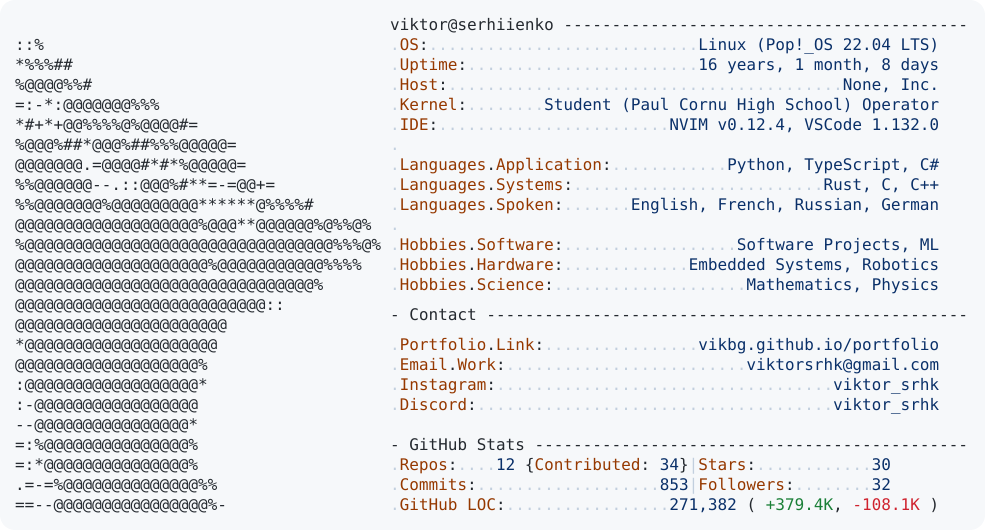

<a href="https://github.com/Vikbg/Vikbg">
  <picture>
    <source
      media="(prefers-color-scheme: dark)"
      srcset="https://raw.githubusercontent.com/Vikbg/Vikbg/main/dark_mode.svg"
    >
    <source
      media="(prefers-color-scheme: light)"
      srcset="https://raw.githubusercontent.com/Vikbg/Vikbg/main/light_mode.svg"
    >
    
  </picture>
</a>

[vstudy](https://vstudy.dev/) is my free study timer. Start a Pomodoro and see your study time build up in a GitHub-style contribution grid.
